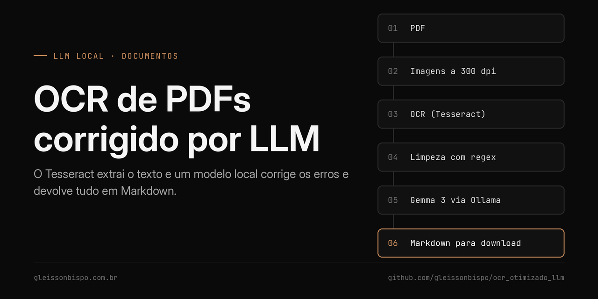
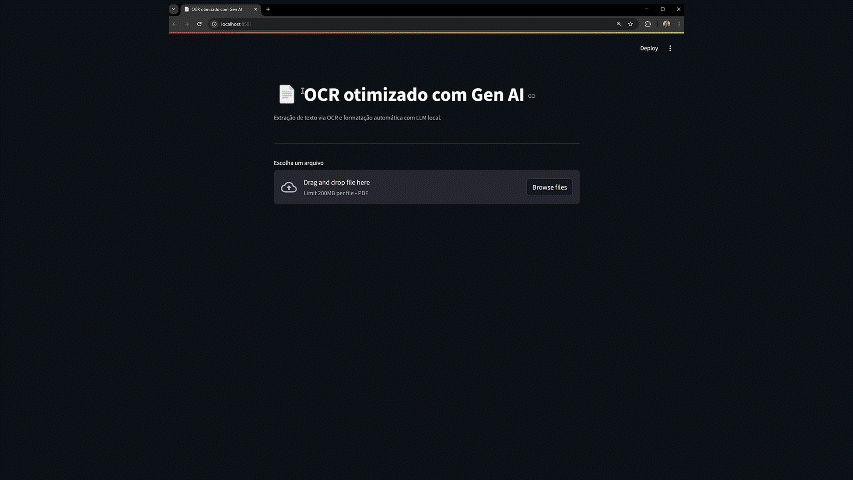
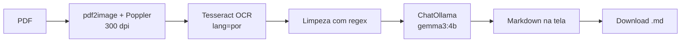

# OCR de PDFs corrigido por LLM local

Aplicação em Streamlit que extrai o texto de um PDF com Tesseract e passa o resultado por um LLM local, que corrige os erros típicos de OCR e devolve o documento formatado em Markdown, pronto para baixar.



## Problema

OCR puro devolve um texto difícil de usar: palavras cortadas por hifenização, quebras de linha no meio da frase, pontuação perdida e nenhuma estrutura de títulos. Quem precisa do conteúdo de um documento escaneado acaba corrigindo tudo à mão. E muitos desses documentos (contratos, holerites, laudos) não podem ser enviados a um serviço em nuvem.

## Solução

Duas etapas em sequência, as duas locais:

1. **Extração.** Cada página do PDF vira uma imagem a 300 dpi e o Tesseract lê o texto em português. Uma limpeza com regex junta as palavras hifenizadas e normaliza espaços e quebras de parágrafo.
2. **Correção e formatação.** O texto limpo vai para o `gemma3:4b` com um prompt restrito: corrigir erros, melhorar a pontuação, preservar a estrutura original e formatar em Markdown, sem comentar nem acrescentar conteúdo.

O app mostra as páginas convertidas, o Markdown renderizado e um botão para baixar o arquivo `.md`.

## Arquitetura



Todo o código está em `app_ocr.py` (cerca de 100 linhas).

## Como rodar

### 1. Dependências do sistema

```bash
# Debian/Ubuntu
sudo apt install tesseract-ocr tesseract-ocr-por poppler-utils
```

No Windows: instale o Tesseract pelo [instalador da UB Mannheim](https://github.com/UB-Mannheim/tesseract/wiki) marcando o idioma português, baixe o [Poppler para Windows](https://github.com/oschwartz10612/poppler-windows/releases) e adicione as duas pastas `bin` ao PATH.

Instale o [Ollama](https://ollama.com) e baixe o modelo (cerca de 3 GB):

```bash
ollama pull gemma3:4b
```

### 2. Projeto

```bash
git clone https://github.com/gleissonbispo/ocr_otimizado_llm.git
cd ocr_otimizado_llm
python -m venv .venv && source .venv/bin/activate   # no Windows: .venv\Scripts\activate
pip install -r requirements.txt
streamlit run app_ocr.py
```

O app abre em `http://localhost:8501`. Para documentos longos ou com muito ruído, vale trocar para `gemma3:12b` em `ChatOllama(model="gemma3:4b")`, ao custo de mais memória e tempo.

## Exemplo de uso

Texto que sai do OCR:

```text
CONTRATO DE PRESTACAO DE SERVICOS
Pelo presente instru-
mento particular , as partes
abaixo qualificadas tem entre si justo e contratado o
seguinte
```

Texto depois do LLM:

```markdown
## Contrato de Prestação de Serviços

Pelo presente instrumento particular, as partes abaixo qualificadas têm entre si justo e contratado o seguinte:
```

O exemplo é ilustrativo. A saída exata depende do documento e do modelo.

## Limitações

- O LLM pode alterar o conteúdo ao "corrigir": trocar um número, um nome próprio ou completar uma frase. Para documento jurídico ou financeiro, confira o resultado contra o original.
- O documento inteiro é enviado em uma única chamada. PDFs longos podem estourar a janela de contexto do modelo e sair truncados.
- Tabelas, colunas múltiplas e formulários não são reconstruídos: o OCR lê linha a linha.
- Idioma fixo em português (`lang='por'`).
- A 300 dpi, PDFs com muitas páginas consomem bastante memória na conversão.
- Não há testes automatizados nem métrica de qualidade (taxa de erro por caractere, por exemplo).

## Próximos passos

- Processar página a página, para suportar documentos longos.
- Mostrar o texto bruto do OCR ao lado do texto corrigido, com as diferenças marcadas.
- Testar modelos multimodais lendo a imagem da página diretamente, sem Tesseract.
- Medir a taxa de erro antes e depois do LLM em um conjunto de documentos de referência.

## Privacidade

OCR e LLM rodam na máquina local. O PDF não é enviado a nenhum serviço externo e nada é gravado em disco pelo app.

## Autor

**Gleisson Bispo**, Gerente de People Analytics. Escrevo sobre dados de pessoas, Data Science e IA aplicada a RH.

- Site: [gleissonbispo.com.br](https://gleissonbispo.com.br) (projetos, artigos, radar de notícias e vagas de People Analytics)
- Este projeto no site: [gleissonbispo.com.br/projetos/ocr-otimizado-llm](https://gleissonbispo.com.br/projetos/ocr-otimizado-llm)
- LinkedIn: [linkedin.com/in/gleissonbispo](https://www.linkedin.com/in/gleissonbispo)
- Newsletter: [People Analytics LAB](https://www.linkedin.com/newsletters/people-analytics-lab-7423156507271368704), no LinkedIn
- GitHub: [@gleissonbispo](https://github.com/gleissonbispo)

